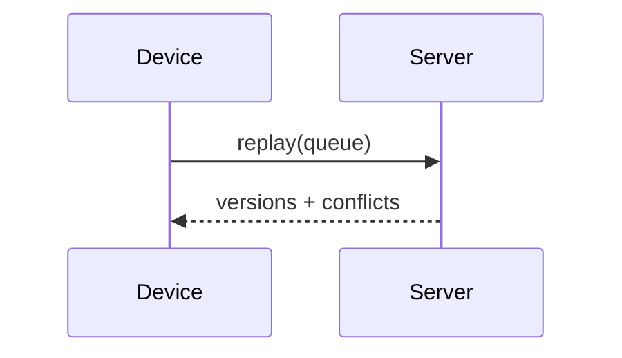

# Offline sync: design

> Status: draft · Owner: platform team

## 1. Goals

1. Edits made offline reach the server when the device reconnects.
2. Two devices editing the same note never lose either side's text. Conflicts are
   rare but must be visible.
3. Sync stays cheap: a reconnect sends only what changed, not the whole store.

## 2. How it works

1. **Queue:** every local change is appended to a queue with its base version.
2. **Replay:** on reconnect the queue is replayed in order.
   - A change whose base version matches is applied.
   - A change whose base version is stale becomes a conflict.

   **A conflict never blocks the queue.** Later changes still replay, and the conflict
   waits for the user.
3. **Ack:** the server returns the new version for each applied change.

## 3. Keyboard shortcuts in the conflict view

| Action | Markdown | Typing shortcut | Phase |
|---|---|---|---|
| Heading | `#` … `######` | `# ` … `###### `; ⌘⌥1–6 | MVP |
| Checklist | `- [ ] task` | `[] ` | MVP |
| Keep mine | — | ⌘⇧M | Later |

---

### 3.1 Open questions

- Should conflicts expire after _30 days_, or stay until resolved?
- Is __one__ queue per device enough, or one per note?

## 4. Server checks

- Endpoints:
  - `sync_push`: applies a batch of queued changes (`applyBatch`).
    Every batch is checked before anything is stored:
    1. It parses with no errors.
    2. It contains no `DROP` statement and no raw markers (`]]>sync:`), which could
       hide one.
    3. Every change names a known note.
